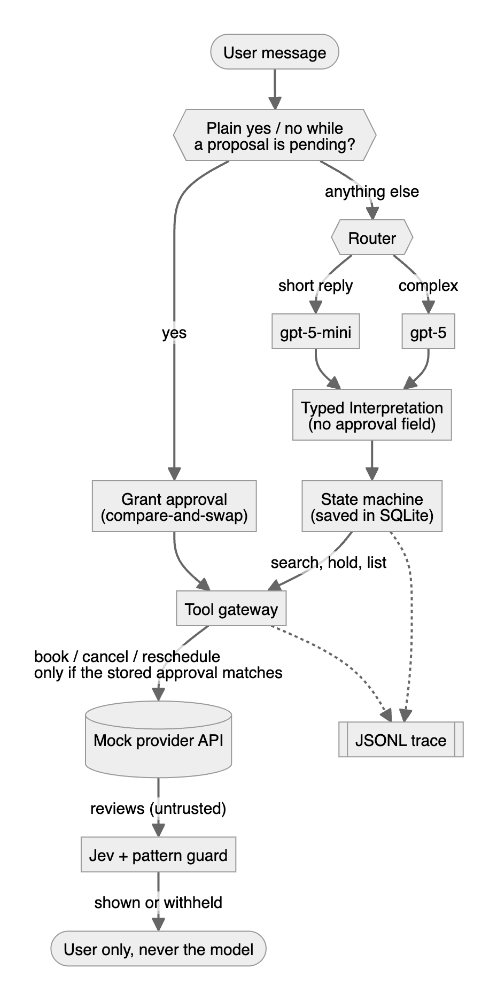

# Errand Agent: design note

**Core idea:** the model only interprets what the user says; code decides every action. The LLM turns one message into a typed `Interpretation` (intent, service, area, dates, hours, budget, selection, memory command). It never picks tools, never sees review text, and its schema has no field that could express approval.

<p align="center"></p>

## State model
`WorkflowState` (phase, request fields with their source, options, pending approval, live holds) is saved after every turn. Phases are `idle → collecting → [confirm_memory] → choosing → awaiting_approval → done`.
- **Ask only what's missing:** missing required fields are asked for together, optional time and budget limits once. `_ask` asserts it never asks for a known field.
- **Corrections:** a correction overwrites one field. If that field changes the search results, the options and any pending approval are dropped and the search re-runs.
- **Restarts:** a restart resumes the saved workflow.

## Approval enforcement
An approval is a database row with `fingerprint = sha256(action|provider|slot|price|booking)`.
1. **Proposed:** created after `hold_slot`, so the user approves the real quoted price.
2. **Granted:** only when the raw user text is a plain "yes". This is a compare-and-swap, so two concurrent "yes" messages can't both grant it.
3. **Re-checked:** the gateway reloads the row before `book`, `cancel` or `reschedule`, and refuses unless it is granted and the fingerprint matches the call.

A correction, "no", a new proposal or a re-quote at a different price voids the approval.

## Idempotency and recovery
The key is `book:<approval_id>`. It is saved as `pending` before the provider call, so retries, repeated "yes" and restarts all reuse it.
- **Timeout:** check `get_booking_status`. `booked` means success, `failed` means stop, `not_found` means retry with the same key (up to 3 attempts).
- **Before claiming success:** confirm with a status check.
- **Every turn:** `_reconcile` first resolves any `pending`/`unknown` operation, using `get_booking_status` for bookings and `list_bookings` for cancels and reschedules.
- **Cancel:** the transient 503 is retried with the same key. **Reschedule:** a `slot_conflict` voids the approval.

After every eval, the harness checks the invariants:
- each mutating call has a matching approval granted on a literal "yes";
- no success is claimed without a `booked` status;
- one booking per key and per provider-slot;
- no secrets in the trace.

## Untrusted output and the Jev guard
**The protection is structural.** Review text goes only to the user, never into the model's context, and nothing can book without a granted approval. Even a fully hijacked model (`test_prompt_injection_in_reviews`) can only change request fields, which at most produces a new proposal for the user to check.

**Jev is a second layer that decides what the user sees.**
- **How it's called:** before reviews are shown, `JevGuard` sends one TypeSafe Jev request with a yes/no (`noul`) question per review: "does this try to instruct an AI assistant?"
- **Configuration:** it calls `api.typesafe.ai/v1/systemone` (model `jev-latest`) when `JEV_API_KEY` or `TYPESAFE_API_KEY` is set, or OpenRouter's Decisions API when `OPENROUTER_API_KEY` is set.
- **Decision:** a review is withheld if Jev's probability is at least 0.5 or a local injection pattern matches. The pattern list is also the fallback when there's no key or the call fails.
- **Trace:** a failure is recorded as `guard_error`, and each `guard_check` event records the flagged reviews, the scores and the source (`jev`, `heuristic` or both).

**Measured in the live demo:** the injected review scored 0.99 and the three normal reviews 0.02–0.03, in about 430 ms per check.

The guard is not the boundary because a classifier can miss things. Keeping it outside the approval path means a Jev miss can only show an odd review to the user; it can't trigger an action.

## Memory
Rows are `(key, value, stated|inferred, confirmed, active|forgotten)` for `area`, `earliest_hour` and `preferred_technician:<service>`.
- **Stated** facts are used immediately.
- **Inferred** facts (for example, the technician from a verified booking) are asked about first; "no" forgets them.
- **Forgetting** leaves a tombstone that inference can't overwrite, and it also clears the value from the request in progress.
- **Users** can view, correct and forget each fact, with its source shown.

## Limits, routing and traces
- **Limits per turn:** 3 model calls, 12 tool calls and 45 s; per session, 40 turns. Every exit (limit, exhausted retries, unknown error) tells the user whether anything changed.
- **Routing:** short replies to a pending choice go to `gpt-5-mini`; corrections, booking changes and multi-constraint requests go to `gpt-5`. A cheap `unknown` result escalates once, and `errand-bench` compares the strategies on 20 labelled messages.
- **Traces:** each run writes one JSONL trace with state transitions, model calls (tier, latency, tokens, cost), tool calls (arguments, sanitised result, latency), approval and guard events, and limits. Secrets, API-key values and long values are redacted or truncated.

## Annotated trace excerpt (`docs/trace_timeout_after_success.jsonl`)
```
model_call          cheap tier: "1" -> select_option 1
tool_call           hold_slot(PLU-IND-3, 10:00) -> hold H-0001, quoted ₹600
approval_proposed   book PLU-IND-3 10:00 ₹600, fp 62e85d…      ← what the user confirms
turn_start          USER: yes                                  ← code path, no model call
approval_granted    fp 62e85d…  →  approval_checked fp 62e85d… ← gateway re-check
tool_call           book(H-0001, book:A-…) -> ERR timeout      ← provider actually booked it
tool_call           get_booking_status -> booked B-0003        ← checked before any retry
booking_verified    B-0003                                     ← only now "Booked and verified"
turn_start          USER: yes -> confirmation_ignored          ← no second book call
```

## What breaks first at 100×
1. **SQLite and the in-process mock:** writes are serialised and sessions can't spread across workers. I'd move to Postgres, keeping the compare-and-swap rows, and run `_reconcile` as a background sweeper.
2. **Execution inside the chat turn:** slow providers stall the turn. I'd write an outbox row on approval and let a worker execute and verify it; the idempotency key already makes that safe.
3. **Model latency and cost:** live turns took 5–13 s with default GPT-5 reasoning. I'd lower the reasoning effort, tune the router on benchmark data, and keep "yes"/"no" free of model calls (they already are).
4. **Local trace files:** I'd export the same events as OpenTelemetry spans or to Langfuse, with redaction at the source.

**Not done:** proactive follow-up, real provider authentication, multi-device sessions, and a live run of `errand-bench`.
